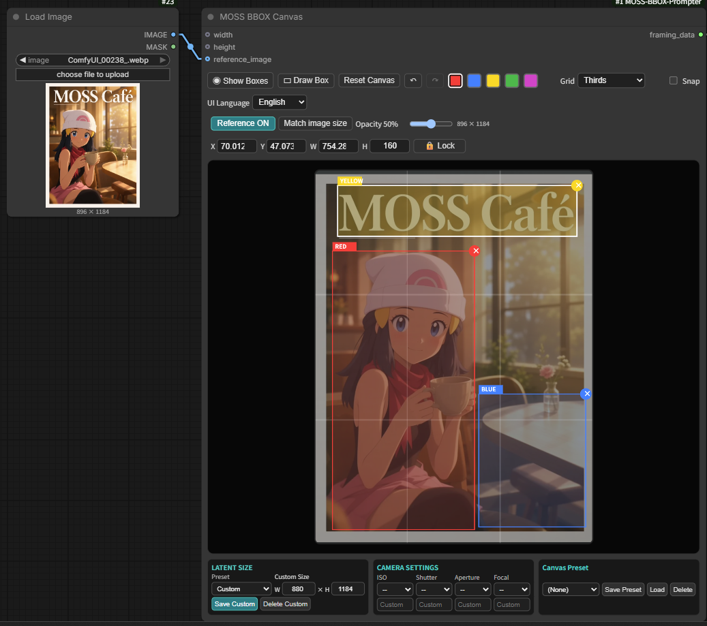
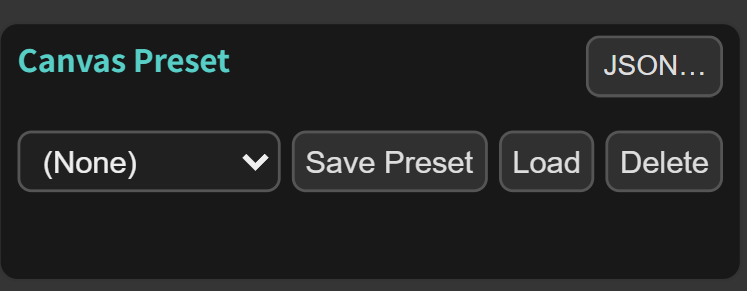
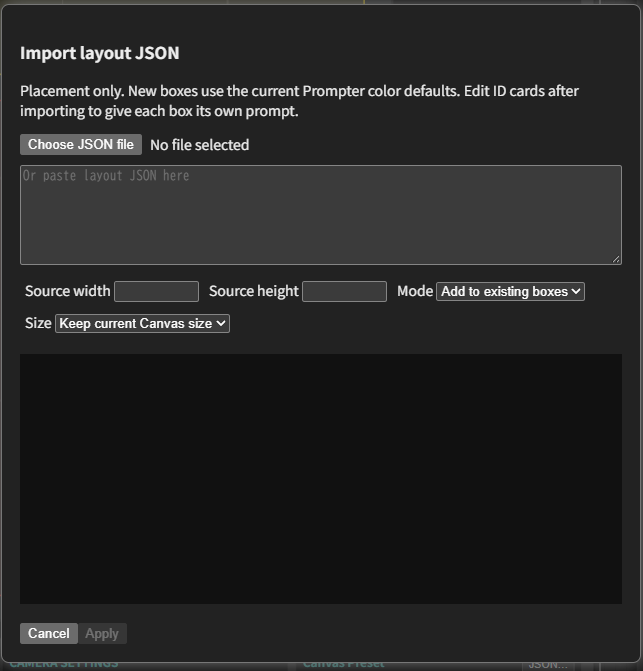

# MOSS BBOX Prompter

[English](README.md) | **日本語**

**最新リリース：1.0.8** — [GitHub Releases](https://github.com/ukr8b3g-cmyk/MossImage-BBOX-Prompter/releases)
・[Comfy Registry](https://registry.comfy.org/nodes/mossimage-bbox-prompter)

**mainの未リリース更新：** 7色対応・外部配置JSON読み込み・ID別プロンプトカードは、GitHubのmainに含まれます。Registryとv1.0.8の配布物にはまだ含まれません。下記の「配置JSON読み込み」と「ID別プロンプトカード」に使い方を記載しています。

MOSS-Image向けに、人物・物体・文字の配置をBBOXで指定するComfyUIカスタムノードです。
Canvasで枠を描き、Prompterで色ごとの説明を入力し、ExportでMOSS用のプロンプトを出力します。
枠は生成への配置指示であり、結果の位置を保証するものではありません。

[Krea2 BBOX Prompter Suite](https://github.com/ukr8b3g-cmyk/Krea2-BBOX-Prompter)のUIを移植・調整しました。
必要なUI・バックエンド処理を同梱しているため、Krea2の別途インストールは不要です。
MITライセンスです。[LICENSE](LICENSE)・[NOTICE.md](NOTICE.md)に出典を記載しています。

## インストール・更新

- **ComfyUI-Manager**：**Install via Git URL**へ次のリポジトリURLを入力します。
  `https://github.com/ukr8b3g-cmyk/MossImage-BBOX-Prompter`
- **手動インストール**：使用するComfyUIの`custom_nodes`フォルダを開き、次を実行します。

  ```shell
  git clone https://github.com/ukr8b3g-cmyk/MossImage-BBOX-Prompter.git
  ```

手動更新はクローンした`MossImage-BBOX-Prompter`フォルダ内で実行します。

```shell
git pull
```

実行中の作業が終了してからComfyUIを再起動し、ブラウザーをCtrl+F5で更新してください。
MOSS-Image対応のComfyUIと、使用するモデル・CLIP・VAEが必要です。
このパッケージによる追加のpip依存関係はありません。

標準のMOSS BBOXテンプレートはNodes 2.0が必要ですが、このパッケージは
**従来のComfyUI UI（LiteGraph）でも使用できます**。Nodes 2.0を有効にする必要はありません。

## ワークフローと接続

[通常版・DMD版・参照画像をまとめたZIP](https://github.com/ukr8b3g-cmyk/MossImage-BBOX-Prompter/releases/download/v1.0.8/MOSS_BBOX_Workflows_1.0.8.zip)
をダウンロードできます。中身は次の3ファイルです。

- [MOSS_BBOX_Standard.json](examples/MOSS_BBOX_Standard.json)：通常版。LoRA OFF・25 steps・CFG 2.5。
- [MOSS_BBOX_DMD.json](examples/MOSS_BBOX_DMD.json)：DMD版。LoRA ON・強度0.7・8 steps・CFG 1。
- [ComfyUI_00238_.webp](examples/ComfyUI_00238_.webp)：参照画像。

同梱2本は880×1184、er_sde／simple、WebP保存（品質80）、BBOX Preview接続済みです。
参照画像の表示は初期OFF・不透明度50％です。参照画像入力を使う今回の2本にはノード1.0.7以降が必要です。
モデル・CLIP・VAE・LoRAのファイル名は、インストール済みのものを選んでください。
テンプレートのLoRAノードには**rgthree-comfy**が必要です。設定値は使用例であり、万能な推奨設定ではありません。

JSONを読み込んだ後、Load Imageで同梱WebPをアップロード・選択してください。
またはComfyUIの`input`フォルダへ元の名前でコピーして選択します。
画像自体はワークフローJSONに埋め込まれていません。

基本の接続は次のとおりです。

1. Canvasの`framing_data` → Exportの`framing_data`。
2. Prompterの`prompt_ui_data` → Exportの`prompt_ui_data`。
3. Exportの`prompt` → 正のCLIP Text Encode。`width`／`height` → Empty Flux 2 Latent。
4. Save WEBP Metaを使う場合はExportの`prompt` → 保存ノードの`positive_text`にも接続し、実際のプロンプトを記録します。

Typeは**Character（人物）／Object（物体）／Text（文字）**を選びます。
同じ色の枠は同じTypeと説明を共有します。旧`obj`設定も受け付けます。
Canvasの座標をMOSS標準の中央原点・ピクセル`yxyx`形式へ変換し、出力します。
プロンプトの翻訳・要約やモデル処理は行いません。

## ローカル実装・未公開：7色の枠・プロンプト

従来の5色にシアン・オレンジを追加し、別々の説明を7種類まで設定できます。
Canvasの追加色を選んで枠を描き、Prompterの同じ色のカードへ説明を入力します。
追加カードは初期状態で閉じ、Character／Object／Text、構図、角度、
Textの共通／個別スタイルと2種類のカラーパレットを既存のUIで使えます。
枠の移動・複製・ロック・整列・Undo／Redo、Previewの色表示にも対応します。

既存23項目の保存順は維持し、追加8項目は末尾の任意入力にしています。
旧5色Workflowは追加2色が空欄になり、従来の出力を維持します。
同じ色の枠は複数作成できるため、枠の上限が7個になるわけではありません。
反映にはComfyUIの再起動とブラウザ更新が必要です。追加色を使用したWorkflowは
このローカル更新版が必要で、公開済み1.0.8では完全には読み込めません。

## 1.0.8：整列・Textスタイル・2種類のカラーパレット

複数の枠を整列・等間隔配置でき、ロックとUndo／Redoに対応します。
Textには書体・太さ・文字色・補足を個別指定でき、初期値は従来の共通設定です。
文字色は自由選択と256マスのプリセット一覧の2通りから選べます。
既存のノードID・保存形式・ワークフローは維持しています。
今回添付する通常版・DMD版のJSONは1.0.7と同じです。
ノード更新後はComfyUIを再起動し、ブラウザも更新してください。

## 1.0.8：Textごとのスタイル

TypeがTextの色カードに「文字スタイル」を追加しました。初期値は**共通設定を使用**で、
従来のExportの`text_style`をそのまま使用します。**個別に指定**を選ぶと、
書体・太さ・文字色・補足欄が表示されます。個別指定はExportの**literalモード**で
その色の共通スタイルを置き換えます。legacyモードは従来どおりです。
Character／Objectでは欄を隠し、Typeや共通設定へ切り替えても個別の入力値は保持します。

書体は自動、セリフ体・明朝系、サンセリフ・ゴシック系、丸文字、筆記体、手書き、
筆文字、ブラックレター、等幅から選択できます。太さは自動・細字・標準・太字です。
文字色は隣の色見本で自由に選択するか、**▦**ボタンでプリセット一覧を開けます。
一覧は約16px角の色見本を**16×16（256マス）**に並べ、クリックで選択します。
ポップアップなのでノードの高さは変わりません。選択後・Esc・外側クリックで閉じます。
どちらも同じ文字色欄へ反映し、選択結果はHEXコードで保存します。
色名や色コード（例：gold、#FFD700）の直接入力も可能です。文字色欄を消すと色指定を解除します。
空欄はパレットで選ぶまで未指定のままです。補足欄では縁取りなどを説明します。
自動・空欄は指示を追加せず、全項目が空の個別指定は見た目の説明なしになります。
生成への描写指示であり、フォントファイルや厳密な書体・色の再現を保証する機能ではありません。

描く文字・空白・改行・引用符は従来の文章欄に保持し、スタイル説明とは分離します。
同じ色のBBOXは同じ文字・スタイルを共有します。設定は既存の`prompt_ui_data`と
UI保存状態に含めるため、ソケット・ウィジェット順は変えません。保存・再読込・複製に対応します。
旧Workflowは共通設定で動きます。反映にはComfyUIの再起動とブラウザー更新が必要です。

## 1.0.8：整列・等間隔配置

未ロック枠を2つ以上選択し、X／Y／W／H・Lockの横の**整列・分布**から操作します。
左揃え・左右中央・右揃え・上揃え・上下中央・下揃えは、選択した枠全体の範囲を基準にします。
横・縦の等間隔配置は3枠以上で有効になり、両端の枠を固定して間の隙間を揃えます。
枠のサイズ・色・説明・ID・保存順は変えず、選択を維持します。吸着より整列結果を優先します。

ロック枠を含む選択、枠非表示、不正な配置データ、ドラッグ中は操作できません。
ロック枠を含む場合は先に解除してください。隙間が足りない場合は重なりが残り、
編集可能なCanvas範囲外になる結果は適用しません。メニュー操作1回がUndo／Redoの1件です。
既に揃っている場合は履歴を増やしません。未選択時もメニューの領域を確保するため、
選択数が変わってもCanvasの高さは変わりません。既存の保存形式とサンプル2本は維持しています。

## 1.0.7：参照画像と枠のロック



**参照画像の使用例:** Load ImageのIMAGEをCanvasのreference_imageへ接続し、
ReferenceをONにすると枠の下に画像が出ます。不透明度で見やすさを調整できます。
表示は初期OFF・50％で、表示切替だけではCanvasのサイズや座標は変わりません。
隣の「画像サイズに合わせる」を押すとサイズと全枠が追従し、Undoで戻せます。
数値欄の隣のLockで枠を固定できます。生成モデルへの画像参照入力とは別の表示機能です。

**接続と操作:** Load ImageのIMAGEをCanvasの`reference_image`へ直接接続します。
生成せず読み込めます。参照画像は初期OFF・不透明度50％で、表示切替だけでは
Canvasの幅・高さ・BBOX位置は変わりません。表示ボタンの隣の「画像サイズに合わせる」
を押した時だけ16の倍数へ合わせ、全枠も追従します（Undo対応）。画像はWorkflowに
埋め込まれないため、ComfyUI側に元ファイルを残してください。
ロックは数値欄の隣で切り替え、保存・Undo／Redoに対応します。ロック枠を含む
グループの移動・複製は解除後に行います。新しい画像入力の登録にはComfyUIの再起動と
ブラウザー更新が必要です。旧ワークフローは接続なしでそのまま使えます。


### ロックの保護範囲

Draw BoxをOFFにして枠を選択し、X／Y／W／Hの隣のLockでロック・解除します。
ロック中も選択できますが、移動・リサイズ・数値編集・削除はできません。
ロック枠を含む選択グループは一括移動・Alt複製できません。Deleteは未ロック枠だけを削除します。
Reset、プリセットの置き換え、Canvas全体のサイズ変更はロック枠にも適用されます。
ロック状態はワークフローに保存され、Undo／Redoに対応します。

### 参照画像の表示とサイズ

画像は縦横比を保ってCanvas内に収め、比率が違う場合は余白を付けます。
表示・不透明度の設定はノードごとに保存します。「画像サイズに合わせる」は
16〜16384の範囲でMOSS用の16の倍数へ丸め、全枠を相対位置・大きさを保って変更します。
画像未読込、不正レイアウト、外部width／height入力で寸法を指定している場合は無効です。
16384pxを超える参照画像は、サイズ合わせの前に縮小してください。

Load Image以外の独立した上流IMAGE入力はCanvas実行後に先頭画像を表示します。
Canvasの下流にある生成出力をCanvas自身へ戻すと循環するため接続しないでください。
既存の生成画像はLoad Imageで読み込めます。参照表示の操作から自動で生成を実行することはありません。
画像ファイルがない場合は再読込が必要です。その他のIMAGE入力は再読み込み後に再実行してください。

## 1.0.6：複数選択・一括移動・複製

**複数選択:** Draw BoxをOFFにし、Ctrl＋クリック（MacはCmd＋クリック）で枠を追加・解除します。
白線の選択枠の内側をドラッグすると一括移動、Alt＋ドラッグで一括複製できます。
色・説明・枠同士の間隔を保ち、Canvas端や吸着は全体に適用します。
矢印キーは全選択枠を1px、Shift併用で10px移動。数値欄と角のリサイズは1枠だけを編集します。
Escapeは選択解除（ドラッグ中は取消）、Deleteは選択枠を一括削除、右上の×はその1枠だけを削除します。
一括操作はUndo／Redoに対応し、選択だけの変更ではRedoを消しません。
配置は従来のWorkflow形式で保存し、選択状態と履歴は再読み込み時にクリアします。

## 1.0.5：Alt複製・縦横比固定

**1.0.5の変更:** Alt＋ドラッグで枠を複製します。動かさないAlt＋クリックは
従来どおり重なった枠の選択です。複製は同じ色の説明を共有します。
Draw Boxは新規作成モードのON／OFFです。点灯中は既存の枠を操作できません。
もう一度押して消灯すると、選択・移動・リサイズ・Alt複製に戻れます。
Shift＋角ドラッグでリサイズ開始時の縦横比を維持し、Shiftを離すと自由リサイズに戻ります。
右上の削除位置もShiftを押してからドラッグすればサイズ変更になります。
比率固定中は吸着より比率を優先します。数値入力・矢印キー・作成時の動作は維持し、
複製とリサイズはUndo／Redoに対応します。

## 1.0.3：生成画像とBBOXの確認用プレビュー

**通常版・DMD版の両方で使用できます。従来UIでも使用でき、Nodes 2.0は不要です。
現在の同梱2本にはPreviewを接続済みです。実行するとPreviewノード内に画像と枠が表示されます。**

以下は旧版・独自WorkflowにPreviewを追加する場合の手順です。

1. 現在のWorkflowを保存します。キャンバスの空白をダブルクリックし、
   **MOSS BBOX Preview**を検索して追加します（`image/MOSS`）。
2. テンプレートの**New Subgraph右側の`IMAGE`出力**を、
   **Preview左側の`images`入力**につなぎます。`MODEL`や`LATENT`ではありません。
   生成処理を展開している場合はVAE Decodeの`IMAGE`を使います。
3. **MOSS BBOX Canvasの`framing_data`出力**を、
   **Previewの`framing_data`入力**にも分岐接続します。Exportへの接続は残します。
4. `IMAGE`からWebP保存ノードへの接続も残します。同じ出力から複数の入力へ分岐できます。
5. 実行すると、**MOSS BBOX Previewノード内**に画像と枠が出ます。
   Canvas内や保存ノード内に自動表示される機能ではありません。
   ノードを追加するだけでは、過去に生成した画像は自動で入りません。

**既存画像を再生成せず確認する場合**は、別の小さなWorkflowにLoad Image、
その画像に使った配置のMOSS BBOX Canvas、MOSS BBOX Previewを置きます。
Load Imageの`IMAGE`→Previewの`images`、Canvasの`framing_data`→Previewの
`framing_data`をつないで実行します。サンプラーやモデルを含まないので画像の再生成は不要です。
確認だけの場合は、生成用Workflow全体を実行しないでください。

Preview内の**Show Boxes**は枠の表示だけを切り替え、**Opacity**は枠の不透明度を
0〜100%で調整します。どちらも再実行不要で、その場で変わります。設定は保存・再読込後と
次の結果にも引き継ぎます。Canvas側のShow Boxesとは別の操作です。
Previewの出力`images`は任意接続で、元画像をそのまま渡します。保存画像に枠は描き込みません。

画像が出ない場合は、Previewがミュート／バイパスされていないこと、2本の入力の接続、
Previewまで正常に実行されたことを確認してください。画像だけが出て枠が見えない場合は、
Show Boxes、Opacityが0%でないこと、接続したCanvasに枠があることを確認します。
一時画像が消去された場合は、上記のLoad Imageを使う方法で表示し直せます。
枠は指定した配置の確認用であり、被写体の検出結果ではありません。切り抜きの補正もしません。

## マウスオーバー説明とExport設定

日本語のComfyUIではマウスオーバー説明も日本語になります。ノード内のUI Languageは
ラベル表示用で、説明の言語はComfyUI本体の設定に従います。標準ウィジェットの説明は
ComfyUIのツールチップ設定を有効にしてください。
`auto_position_hint`は「左上」などの位置を表す英文をcaption／hybridに補う機能で、
枠の自動配置ではありません。`layout_json`と、BBOXがある場合の`auto`には影響しません。
`literal`ではText欄に描く文字そのもの、`text_style`に共通の書体・色・縁取りを入力します。
Textには対応する色のBBOXも用意してください。枠がないTextは配置JSONから省略されます。

## 旧ワークフローの互換性

旧Workflowは現在のノードでも使用できます。現在の同梱2本はPreview接続済みで、
v1.0.0の旧2本にはPreviewが含まれていません。今後は各GitHub Releaseに、その版に対応する通常版・DMD版のJSONを添付し、
旧版のタグとファイルも保持します。下の表から旧版を直接ダウンロードできます。
提供された通常版・DMD版で既存2本を差し替えました。表の「現在のmain」から最新版をダウンロードできます。
Preview入りWorkflowにはv1.0.3以降が必要です。日本語説明・縮小表示・座標欄の修正はv1.0.4に含まれます。

| バージョン | 通常版 | DMD版 |
| --- | --- | --- |
| [v1.0.8](https://github.com/ukr8b3g-cmyk/MossImage-BBOX-Prompter/releases/tag/v1.0.8) | [JSONをダウンロード](https://github.com/ukr8b3g-cmyk/MossImage-BBOX-Prompter/releases/download/v1.0.8/MOSS_BBOX_Standard.json) | [JSONをダウンロード](https://github.com/ukr8b3g-cmyk/MossImage-BBOX-Prompter/releases/download/v1.0.8/MOSS_BBOX_DMD.json) |
| [v1.0.7](https://github.com/ukr8b3g-cmyk/MossImage-BBOX-Prompter/releases/tag/v1.0.7) | [JSONをダウンロード](https://github.com/ukr8b3g-cmyk/MossImage-BBOX-Prompter/releases/download/v1.0.7/MOSS_BBOX_Standard.json) | [JSONをダウンロード](https://github.com/ukr8b3g-cmyk/MossImage-BBOX-Prompter/releases/download/v1.0.7/MOSS_BBOX_DMD.json) |
| [v1.0.6](https://github.com/ukr8b3g-cmyk/MossImage-BBOX-Prompter/releases/tag/v1.0.6) | [JSONをダウンロード](https://github.com/ukr8b3g-cmyk/MossImage-BBOX-Prompter/releases/download/v1.0.6/MOSS_BBOX_Standard.json) | [JSONをダウンロード](https://github.com/ukr8b3g-cmyk/MossImage-BBOX-Prompter/releases/download/v1.0.6/MOSS_BBOX_DMD.json) |
| [v1.0.5](https://github.com/ukr8b3g-cmyk/MossImage-BBOX-Prompter/releases/tag/v1.0.5) | [JSONをダウンロード](https://github.com/ukr8b3g-cmyk/MossImage-BBOX-Prompter/releases/download/v1.0.5/MOSS_BBOX_Standard.json) | [JSONをダウンロード](https://github.com/ukr8b3g-cmyk/MossImage-BBOX-Prompter/releases/download/v1.0.5/MOSS_BBOX_DMD.json) |
| [v1.0.4](https://github.com/ukr8b3g-cmyk/MossImage-BBOX-Prompter/releases/tag/v1.0.4) | [JSONをダウンロード](https://github.com/ukr8b3g-cmyk/MossImage-BBOX-Prompter/releases/download/v1.0.4/MOSS_BBOX_Standard.json) | [JSONをダウンロード](https://github.com/ukr8b3g-cmyk/MossImage-BBOX-Prompter/releases/download/v1.0.4/MOSS_BBOX_DMD.json) |
| 現在のmain（参照画像入力：1.0.7以降） | [JSONをダウンロード](https://github.com/ukr8b3g-cmyk/MossImage-BBOX-Prompter/raw/refs/heads/main/examples/MOSS_BBOX_Standard.json) | [JSONをダウンロード](https://github.com/ukr8b3g-cmyk/MossImage-BBOX-Prompter/raw/refs/heads/main/examples/MOSS_BBOX_DMD.json) |
| [v1.0.0](https://github.com/ukr8b3g-cmyk/MossImage-BBOX-Prompter/releases/tag/v1.0.0) | [JSONをダウンロード](https://github.com/ukr8b3g-cmyk/MossImage-BBOX-Prompter/raw/refs/tags/v1.0.0/examples/MOSS_BBOX_Standard.json) | [JSONをダウンロード](https://github.com/ukr8b3g-cmyk/MossImage-BBOX-Prompter/raw/refs/tags/v1.0.0/examples/MOSS_BBOX_DMD.json) |

## 座標入力・矢印キー・吸着

選択枠のX／Y／W／Hをピクセルで入力し、Enterまたは欄から離れると適用します。
Escapeは未確定の入力を取り消します。幅・高さは正の値を使い、編集可能なCanvas範囲に制限します。
Canvasにフォーカスがあるとき、矢印キーで1px、Shift併用で10px移動します。
文字・数値欄では通常の入力操作を維持します。

Gridの横のSnapで、ドラッグ中に枠の端・中央を中央線や三分割線へ吸着させます。
リサイズ時は動かしている辺だけが対象です。吸着距離は表示上6pxです。
初期OFFで、ワークフロー読込・Reset時にもOFFへ戻ります。
数値入力と矢印キーは吸着より指定値を優先します。新規作成は自由描画です。

## Undo／Redo・重なった枠の選択

↶／↷、Ctrl／Cmd＋Z、Ctrl＋YまたはCtrl／Cmd＋Shift＋ZでCanvasの編集を戻す・やり直します。
ドラッグ1回は履歴1件で、Canvasごとに最大60件です。履歴は編集中だけ保持し、読み込み時にクリアします。
文字・数値入力欄では通常の編集履歴が優先されます。Alt＋クリックで重なった枠の選択を切り替えられます。
選択だけでは枠の配列順やプロンプトを変更しません。

## 破損レイアウトの保護（1.0.1）

保存データのJSON・配置構造が不正な場合、原文を保持し、色や表示の変更・保存で空配置へ置き換えません。
描画やプリセット読込を停止し、Reset Canvasまたは正常なワークフローの読込で復帰します。
意図した空レイアウトは引き続き使えます。

## 検証と旧ノード

1.0.7の公開CIはPython47件・JavaScript36件、構文・Ruff・全42ファイルの配布物確認に成功しました。
ロック・参照画像の動作はユーザーがComfyUI上で確認済みです。
隔離ブラウザー試験とCPUテンソル確認は実施しましたが、今回の公開作業でGPU生成は追加実行していません。
過去の通常版・DMD版GPU確認は別の記録です。詳しくは[TEST_REPORT.md](TEST_REPORT.md)を参照してください。

旧Canvas／Prompter／Hybridノードと保存形式は互換性のため残しています。
新規作成は現在のCanvas／Prompter／Exportを使用してください。
旧ノードの詳細仕様、出力スキーマ、開発者向け検証手順は[英語版README](README.md#legacy-separate-canvas-and-prompter)に記載しています。

### 配置JSON読み込み（main・未リリース）



Canvasの描画領域の下にある **Canvas Preset** 欄の右上が、**JSON…** ボタンです。



ファイル選択または貼り付けの後、配置プレビューを確認し、反映方法を選べます。画像は英語UIの例です。ComfyUIが日本語設定なら、この読み込み画面も日本語になります。

1. **JSON…** を押して読み込み画面を開きます。
2. **JSONファイルを選択** で `.json` ファイルを選ぶか、入力欄にJSONを貼り付けます。
3. JSONに元画像の寸法が含まれていない場合は、**元の幅・元の高さ** を入力します。
4. プレビューと色の割り当てを確認します。初期値は **既存枠に追加・現在のCanvasサイズを維持** です。
5. **適用** で取り込みます。**取消** なら配置は変わりません。

読み込み画面・ファイル選択ボタン・未選択の表示は **ComfyUI本体の表示言語** に従います。Canvasに保存したUI Languageとは独立しています。言語を変更した場合は、読み込み画面を閉じて開き直してください。

取り込み内容は **配置のみ** です。新しい枠の文章・Type・スタイルは現在のPrompterの色別設定を使用します。取り込み後に **ID別カード** を編集すると、8個目以降も枠ごとに別の文章を指定できます。個別指定しない枠は同色の説明を共有します。

対応形式はMOSS Layout JSON（items／yxyx／abs_centralized）とCanvasのboxes（ピクセル座標x1/y1/x2/y2）です。元の幅・高さがない場合は入力してください。枠の最大座標からサイズを推測しません。縦横比が違う場合は縦横を別々に拡縮します。元サイズへ変更する場合は16の倍数が必要で、外部サイズ接続中は変更できません。ロック枠がある場合も置き換え・サイズ変更はできませんが、追加は可能です。

適用全体をUndo／Redo各1回で戻せます。画像端・範囲外の座標も保存・再読み込みで維持し、黙って切り詰めません。不正・未対応JSONは理由を表示して適用を止めます。文章・参照画像・カメラ設定は取り込みません。Workflow全体のJSONを読み込む機能ではありません。

**プリセットの持ち出しについて：** Save Preset／Load／DeleteはCanvasプリセットを管理する操作で、プリセットJSONをファイルとしてダウンロードする機能ではありません。JSON画面は現在、配置の読み込み専用です。配置とID別の文章を残す場合は、ComfyUIのWorkflow全体を保存してください。配置・プリセット専用のエクスポートは未実装です。

### ID別プロンプトカード（main・未リリース）

Canvasのframing_dataとPrompterのprompt_ui_dataを同じMOSS BBOX Exportへ接続します。Prompterの **ID別カード** を選ぶと、枠ごとのカードを表示します。Canvasで枠を作成・読み込みすると8個目以降も追加されます。同じPrompterが複数CanvasのExportに接続されている場合は、選択欄でCanvasを指定してください。直接接続とReroute経由に対応します。

既存ワークフローは色別設定を維持します。IDカードを編集した枠だけ、文章・Character／Object／Text・構図・角度・Textスタイルが独立します。「色別設定へ戻す」で個別指定を解除できます。色は表示上の区別と初期設定で、個別カードの識別にはIDを使用します。任意の名前も付けられます。枠の選択で対応カードを開き、カードの選択で枠を強調します。スクロールはPrompter内部に収めます。

個別設定は枠IDと一緒にCanvasの配置へ保存されます。CanvasのUndo／Redoで文章編集も戻せ、IDカード側の矢印ボタンからも操作できます。Alt複製は設定をコピーした新しいIDを作り、その後の編集は独立します。削除した枠をUndoすると文章も戻ります。枠のロック中も文章は編集できます。両ノードを含むWorkflowを保存してください。更新したバックエンドを使うためComfyUI再起動とブラウザー更新が必要です。旧バージョンは新しいID別設定を解釈できません。
