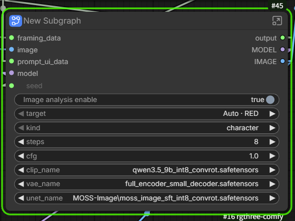
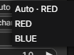
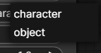
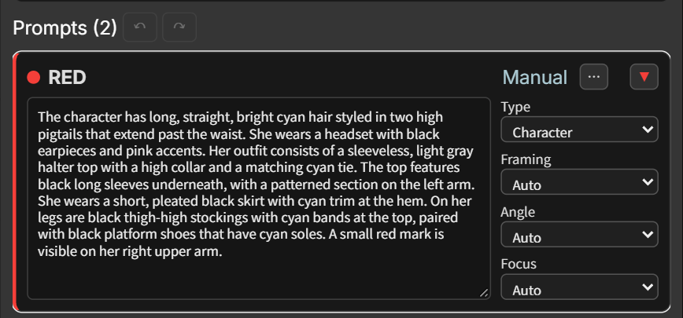
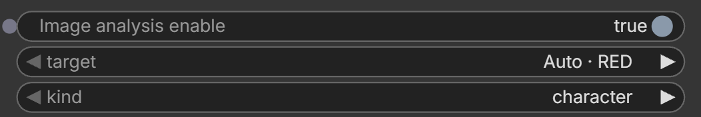
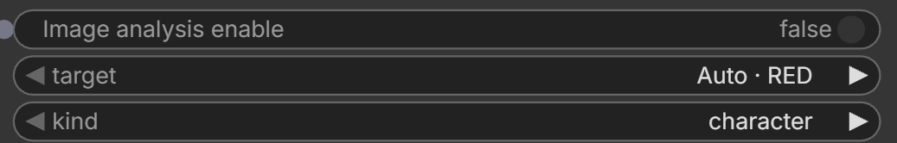

# MOSS BBOX Prompter

[English](README.md) | **日本語** · **v2.0.1** · [Release](https://github.com/ukr8b3g-cmyk/MossImage-BBOX-Prompter/releases/tag/v2.0.1)

ComfyUIで色付きの枠を配置し、人物・物体・文字のプロンプトを枠ごとに指定します。配置は**Canvas**、文章は**Prompter**で指定し、両方を同じ**Export**へ接続してMOSS-Image用のプロンプトにまとめます。

7色・同色の複数枠、Angle／Framing／Focus、吹き出し、参照画像、Undo／Redoに対応。V2では**参照画像の解析 → 枠へ自動入力 → OFF後に編集**を追加し、V1のWorkflow・保存設定も維持しています。

## 導入とWorkflow

1. **ComfyUI-Manager → Install via Git URL**へ[このリポジトリ](https://github.com/ukr8b3g-cmyk/MossImage-BBOX-Prompter)のURLを入力します。
2. 作業を保存し、実行中の処理が終わってからComfyUIを通常再起動し、**Ctrl+F5**で更新します。MOSS-Image対応のComfyUIが必要です。
3. 下のWorkflowを読み込み、モデル・TE・VAE・LoRAを手元のファイルに合わせます。V2テンプレートには[rgthree-comfy](https://github.com/rgthree/rgthree-comfy)とCoreのGenerate Text／If/Else Switch／Seedが必要です。Krea2の別途導入は不要です。

| Workflow | ダウンロード | 用途 |
| --- | --- | --- |
| **V2・2.0.1** | [参照画像付きZIP](https://github.com/ukr8b3g-cmyk/MossImage-BBOX-Prompter/releases/download/v2.0.1/MOSS_BBOX_Canvas_V2.zip) ／ [JSON](examples/MOSS_BBOX_Canvas_V2.json) | 今回のテンプレート。解析の初期値はOFFで、従来どおり手入力でも使えます。 |
| V1・1.0.11 | [前版Release](https://github.com/ukr8b3g-cmyk/MossImage-BBOX-Prompter/releases/tag/v1.0.11) ／ [Template JSON](https://github.com/ukr8b3g-cmyk/MossImage-BBOX-Prompter/releases/download/v1.0.11/MOSS_BBOX_Template.json) | 従来の構成。過去Releaseも保持しています。 |

V2 ZIPを展開し、`examples/MOSS_BBOX_Canvas_V2.json`を開きます。**Load Image**には同梱の`ed6c61ad22695e639fb4b5b75fd2b931.webp`か自分の参照画像を選択してください。新規ノードのプロンプト初期値は空欄で、テンプレートの例文は自動コピーしません。

## 画像解析の使い方

### 1. 画像と対象枠を選ぶ

生成サブグラフに、通常の生成設定と並んで**Image analysis enable・target・kind**があります。

| target — 入力先の枠 | kind — 解析する内容 |
| --- | --- |
|  |  |
| **Auto**は最初に作成・保存された枠を使い、`Auto · RED`など対象色も表示します。入力先を固定する場合は枠を明示指定してください。 | 人物は**character**、物体は**object**。カードのTypeを変更する設定ではありません。 |

**Missing box／対象なし**は有効な入力先がない状態です。解析ONで実行するとエラーになるため、枠を作るか実在する枠を選び直してください。今回の解析範囲は**参照画像1枚・対象枠1つ**です。Autoが選んだ場合も含め、Text枠は解析対象外です。

### 2. ONで解析・生成

**Image analysis enable = true**にして、通常の**実行**を押します。解析文が指定カードへ自動保存され、その文章で画像生成します。コピー・貼り付けや専用の適用ボタンは不要です。

### 3. OFFで編集

**Image analysis enable = false**にすると本文は残り、**Manual**として編集できます。全く別の文章への変更も可能です。再実行すると、その保存済み本文で従来どおり生成します。

**再びONで実行すると、手動編集した本文も新しい解析文で上書きされます。** ONへ切り替えるだけでは解析しません。編集文を使う間はOFFのままにし、Workflow全体を保存してください。

**v2.0.1の上書き保護** 画像・対象・本文・座標・Type・Switchの変更後に届く旧結果は保存しません。UndoやOFF→ONでも復活しません。実行中のジョブ自体は実行要求時の入力で完了します。GitHubから更新後、ComfyUIを通常再起動し、Ctrl+F5で反映してください。

ON／OFFの操作画面

**ON（true）**：実行すると参照画像を解析し、指定枠へ保存します。

**OFF（false）**：参照画像を再解析せず、カードに保存された本文を使います。

参照画像を文章化する機能で、画像を直接条件付けする機能ではありません。同一人物・正確な文字・完全再現は保証しません。OFFでも接続したLoad Imageには有効な画像が必要です。[解析設定・詳しい動作](docs/REFERENCE.ja.md#解析設定とシステムプロンプト)。

## 基本操作

| 操作 | 使い方 |
| --- | --- |
| 枠の編集 | 各カードを編集。Typeで人物・物体・文字を選び、Framing・Angle・Focusで描写を補います。Textで使わない設定は同じ位置で無効表示します。 |
| 背面の枠を選択 | Canvasの右クリックメニュー、またはAlt＋クリックで重なった枠を切り替えます。メニューから前面への移動もできます。 |
| 移動・複製・保護 | 複数選択、整列・等間隔配置、Altドラッグ複製、Lock。CanvasのUndo／Redoで戻せます。 |
| セリフ | 別のText枠へ描く文字だけを入力。用途・形状を選び、「文字・吹き出し」で色・方向・書体を設定します。😀で絵文字を挿入。Exportは`text_mode=literal`にします。 |
| 共通設定・名前 | 通常は実際の枠カードだけを表示。共通設定は必要なときに開き、カードの**⋯**から名前・Sharedを操作します。Sharedでの置換は内容を確認して実行します。 |
| 保存 | CanvasとPrompterを含むWorkflow全体を保存。枠ごとの本文・Type・スタイル・開閉・手動変更した入力欄サイズを保持します。 |

## 任意の接続

- **外部STRING**：文章処理・LLMノード → **MOSS BBOX Text Link.text**、Canvas.framing_data → Text Link.framing_dataを接続し、Boxを選択。Text Link.external_text → Prompter.external_textへ渡します。カードは外部文章の読み取り専用プレビューとなり、接続を外すと保存済みの手入力へ戻ります。[詳細](docs/REFERENCE.ja.md#外部テキスト任意のstring接続)。
- **Krea2エフェクト**：[Krea2 BBOX Prompter Suite](https://github.com/ukr8b3g-cmyk/Krea2-BBOX-Prompter)のBackground Effect／BBOX Prompt EffectをExportの後ろへ任意で追加できます。**Export.prompt_text → Effect.prompt_in → Effect.prompt_out → CLIP Text Encode.text**。2種類の連結も可能です。元のプロンプトを保持するため`prompt_out`を使います。[配線図](docs/REFERENCE.ja.md#krea2の背景エフェクトを追加する接続)。

[詳細ガイド・旧版の記録](docs/REFERENCE.ja.md) · [検証記録](https://github.com/ukr8b3g-cmyk/MossImage-BBOX-Prompter/blob/main/TEST_REPORT.md) · [不具合報告](https://github.com/ukr8b3g-cmyk/MossImage-BBOX-Prompter/issues)

V2のGPU動作はユーザー確認済みです。開発側のCPU・画面・保存復元・配布物の検証とは区別して検証記録に記載しています。GitHub ReleaseとRegistry公開は別工程です。

MIT License · Krea2 BBOX Prompter SuiteのUIを移植。帰属は[LICENSE](LICENSE)・[NOTICE.md](NOTICE.md)を参照してください。
