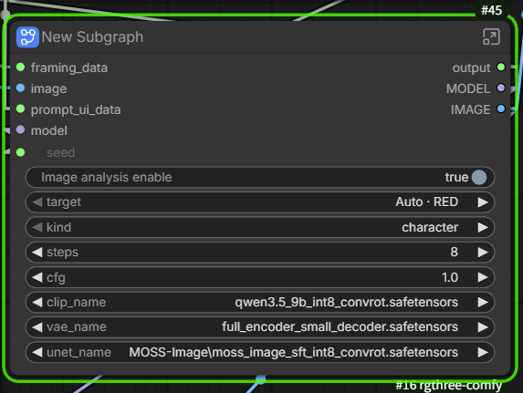
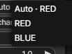
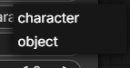
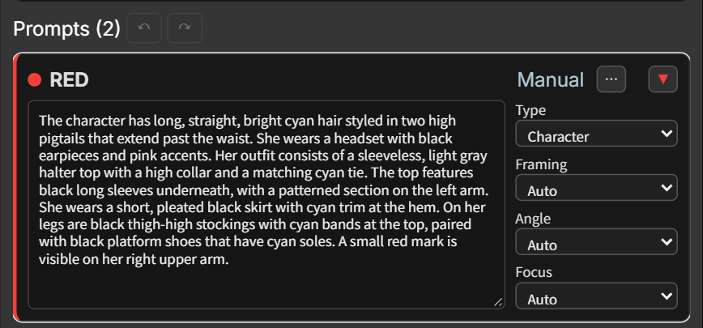
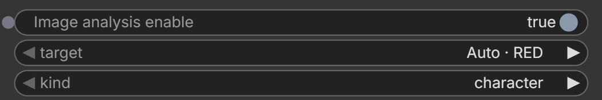
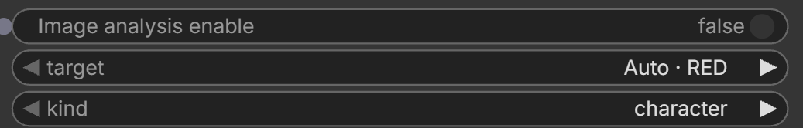

# MOSS BBOX Prompter

**English** | [日本語](README.ja.md) · **v2.0.0** · [Release](https://github.com/ukr8b3g-cmyk/MossImage-BBOX-Prompter/releases/tag/v2.0.0)

Arrange colored boxes in ComfyUI and write a prompt for each character, object or text area. **Canvas** defines placement and **Prompter** supplies words; connect both to the same **Export** to build the MOSS-Image prompt.

Seven colors, multiple boxes of the same color, Angle/Framing/Focus, dialogue styles, reference images and Undo/Redo are included. V2 adds **reference-image analysis → automatic box text → editing after OFF**, while retaining V1 workflows and saved settings.

## Install and open a workflow

1. In **ComfyUI-Manager → Install via Git URL**, enter [this repository](https://github.com/ukr8b3g-cmyk/MossImage-BBOX-Prompter).
2. Save your work, finish running jobs, restart ComfyUI normally, then press **Ctrl+F5**. Use a ComfyUI version with MOSS-Image support.
3. Load a workflow below and select your installed model, TE, VAE and LoRA files. The V2 template needs [rgthree-comfy](https://github.com/rgthree/rgthree-comfy) and Core Generate Text / If/Else Switch / Seed nodes. No separate Krea2 installation is required.

| Workflow | Download | Use |
| --- | --- | --- |
| **V2 · 2.0.0** | [ZIP with reference image](https://github.com/ukr8b3g-cmyk/MossImage-BBOX-Prompter/releases/download/v2.0.0/MOSS_BBOX_Canvas_V2.zip) / [JSON](examples/MOSS_BBOX_Canvas_V2.json) | Current template. Analysis starts OFF; ordinary prompting works as before. |
| V1 · 1.0.11 | [Previous release](https://github.com/ukr8b3g-cmyk/MossImage-BBOX-Prompter/releases/tag/v1.0.11) / [Template JSON](https://github.com/ukr8b3g-cmyk/MossImage-BBOX-Prompter/releases/download/v1.0.11/MOSS_BBOX_Template.json) | Previous setup. Older release history is retained. |

Extract the V2 ZIP and open `examples/MOSS_BBOX_Canvas_V2.json`. Upload/select the included `ed6c61ad22695e639fb4b5b75fd2b931.webp` in **Load Image**, or use your own reference. New nodes start with blank prompts; sample workflow wording is not copied into them.

## Reference-image analysis

### 1. Choose an image and a box

The generation subgraph exposes **Image analysis enable**, **target** and **kind**, alongside the usual generation settings.

| target — destination box | kind — analysis subject |
| --- | --- |
|  |  |
| **Auto** uses the first created/stored box and displays its color, such as `Auto · RED`. Select a box explicitly to keep the destination fixed. | **character** describes a person; **object** describes an object. This does not change the card's Type. |

**Missing box** means there is no valid target. With analysis ON, running raises an error: create a box or select an existing one first. This version analyzes **one reference image and one box**. Text targets are excluded, including when Auto selects a Text box.

### 2. Turn ON and Run

Set **Image analysis enable = true**, then press the ordinary **Run** button. The analyzed text is saved automatically to the selected card and used for image generation. No copy/paste or separate Apply button is needed.

### 3. Turn OFF to edit

Set **Image analysis enable = false**. The text stays in the card, becomes **Manual**, and can be edited or replaced. Run again to generate from that saved text, as with ordinary prompting.

**Running again with analysis ON overwrites manual edits with the new analysis.** Switching ON alone does not analyze anything. Keep it OFF while using your edited wording; save the whole workflow to retain it.

**Safety fix on current main:** changing the image, target, body, coordinates, Type or Switch invalidates pending results; Undo or OFF→ON does not revive them. An in-flight job still finishes with its queued inputs. Update from GitHub, restart ComfyUI and press Ctrl+F5.

ON / OFF control screenshots

**ON (`true`)**: Run analyzes the image and saves the result to the selected target.

**OFF (`false`)**: Run uses the saved card text; it does not reanalyze the image.

The reference is described as text; it is not direct image conditioning. Exact identity, lettering or reproduction is not guaranteed. Even while OFF, connected Load Image inputs must contain a valid image. [Analysis settings and detailed behavior](docs/REFERENCE.md#analysis-settings-and-system-prompt).

## Everyday controls

| Task | Operation |
| --- | --- |
| Edit a box | Use its card. Type selects Character / Object / Text; Framing, Angle and Focus add composition hints. Text keeps unused controls disabled. |
| Select a covered box | Use the Canvas right-click menu or Alt+click to cycle overlapping boxes. The menu also provides foreground ordering. |
| Move / copy / protect | Multi-select, align/distribute, Alt-drag to duplicate, and Lock. Canvas Undo/Redo restores edits. |
| Dialogue | Use a separate Text box for exact words. Set Usage/Shape; open Lettering / Bubbles for colors, direction and style. 😀 inserts emoji. Use Export `text_mode=literal`. |
| Shared settings / name | Normally only actual box cards appear. Open Shared defaults when needed; card **⋯** contains Name and Shared. Shared replacement previews the change and asks for confirmation. |
| Save | Save both Canvas and Prompter in the workflow. Per-box text, Type, styles, expansion and manual editor sizes are retained. |

## Optional connections

- **External STRING**: text-processing/LLM node → **MOSS BBOX Text Link.text**; Canvas.framing_data → Text Link.framing_data; select Box; Text Link.external_text → Prompter.external_text. The card previews external text read-only. Unlinking restores its saved manual text. [Details](docs/REFERENCE.md#external-text-optional-string-connections).
- **Krea2 effects**: [Krea2 BBOX Prompter Suite](https://github.com/ukr8b3g-cmyk/Krea2-BBOX-Prompter) optionally adds Background Effect / BBOX Prompt Effect after Export. Connect **Export.prompt_text → Effect.prompt_in → Effect.prompt_out → CLIP Text Encode.text**. Chain both effects if desired; use `prompt_out` to keep the original prompt. [Wiring guide](docs/REFERENCE.md#connecting-krea2-background-and-prompt-effects).

[Detailed guide and older-version notes](docs/REFERENCE.md) · [Validation](https://github.com/ukr8b3g-cmyk/MossImage-BBOX-Prompter/blob/main/TEST_REPORT.md) · [Issues](https://github.com/ukr8b3g-cmyk/MossImage-BBOX-Prompter/issues)

V2 GPU operation was confirmed by the user. CPU/UI, saved-state and packaging checks are recorded separately in the validation report. GitHub Releases and Registry publication are separate.

MIT License · UI adapted from Krea2 BBOX Prompter Suite. See [LICENSE](LICENSE) and [NOTICE.md](NOTICE.md).
