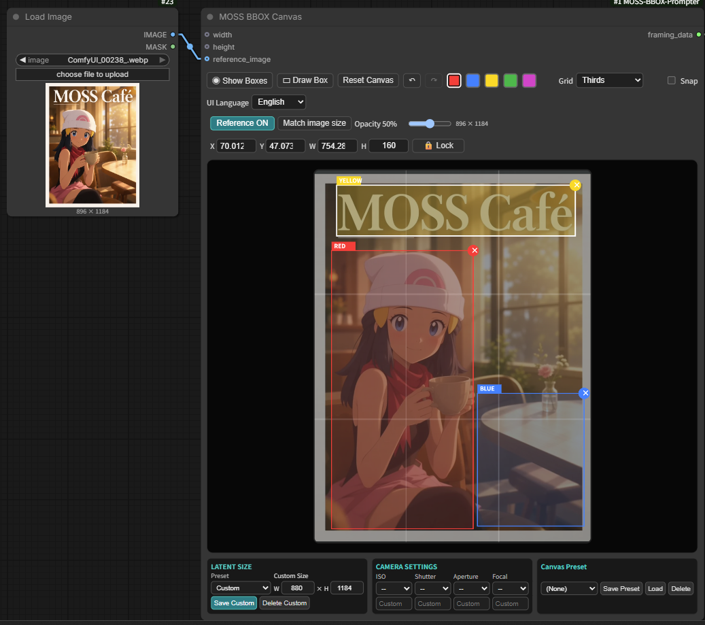
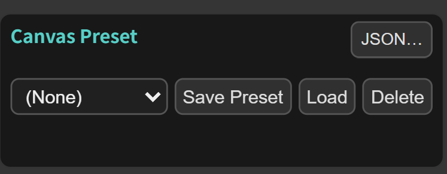
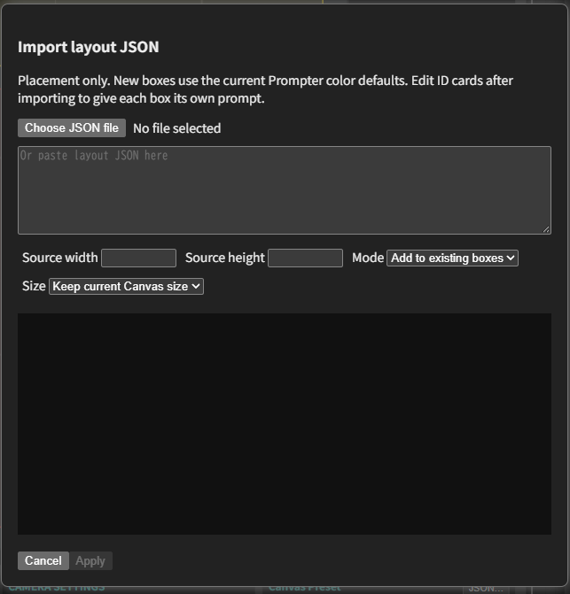

# MOSS BBOX Prompter — 詳細ガイド・旧版の記録

[短いREADMEへ戻る](../README.ja.md)。設定一覧と旧版の操作・実装・検証記録を残しています。過去の試験件数や生成設定は、V2全体の保証・共通推奨値ではありません。

[English](REFERENCE.md) | **日本語**

**GitHub最新版：2.0.0（V2）** — [Release・Workflowダウンロード](https://github.com/ukr8b3g-cmyk/MossImage-BBOX-Prompter/releases/tag/v2.0.0) ・ [Comfy Registry](https://registry.comfy.org/nodes/mossimage-bbox-prompter)

**V2の追加機能：** 参照画像の解析、対象枠への自動保存、OFF後の編集、Auto対象、解析設定の表示。V1との互換性を維持します。

## V1から引き継いだ機能（1.0.11）

- 接続前後で共通のコンパクトなカード表示。全7色で同じ4段・書体・幅・初期170px。保存済みの手動サイズは保持します。
- 名前とSharedは見出しの **⋯**、色の共通設定の⋯はプリセット。画面の説明は短いラベルとマウスオーバーへ整理しました。
- Type・本文・開閉・入力欄サイズの保存復元を修正。枠の選択だけで閉じたり、別の文章・設定へ戻したりしません。
- Angleに斜め後ろ左右と覗き見るローアングル、独立したFocusを追加。詳細は下記のAngle／Focusへ。
- Textに用途7種・形状22種・構造・文字方向・色・絵文字一覧を追加。描く本文と見た目の指示を分けます。
- [V1テンプレート](https://github.com/ukr8b3g-cmyk/MossImage-BBOX-Prompter/releases/download/v1.0.11/MOSS_BBOX_Template.json)を追加。本文・生成設定を保持し、表示寸法を統一しました。**新規ノードの初期文章は空欄**で、例の文章をコピーしません。
- 未接続の旧width_override／height_override端子を取り除き、Canvas上部を短縮。接続済みの旧端子と下部W／H入力は維持します。

**更新時：** Workflowを別名保存し、処理が終わってから更新してください。1.0.10以前からはFocusなどのPython入力も変わるため、ComfyUIを通常の方法で再起動し、その後Ctrl+F5で更新します。Registry公開はGitHub Releaseと別工程です。

**1.0.9の更新：** 7色対応・外部配置JSON読み込み・ID別プロンプトカード・JSON書き出しと再編集用の再読み込みを追加しました。読み込みの初期値は「枠を置き換え」で、Canvasプリセットの削除時には確認が出ます。下記の「配置JSON読み込み」「JSON書き出しと再編集用の読み込み」「ID別プロンプトカード」に使い方を記載しています。更新後はComfyUIを再起動し、ブラウザを更新してください。

MOSS-Image向けに、人物・物体・文字の配置をBBOXで指定するComfyUIカスタムノードです。
Canvasで枠を描き、Prompterで枠ごとの説明を入力し、ExportでMOSS用のプロンプトを出力します。
枠は生成への配置指示であり、結果の位置を保証するものではありません。

[Krea2 BBOX Prompter Suite](https://github.com/ukr8b3g-cmyk/Krea2-BBOX-Prompter)のUIを移植・調整しました。
必要なUI・バックエンド処理を同梱しているため、Krea2の別途インストールは不要です。
MITライセンスです。[LICENSE](../LICENSE)・[NOTICE.md](../NOTICE.md)に出典を記載しています。

## インストール・更新

- **ComfyUI-Manager**：**Install via Git URL**へ次のリポジトリURLを入力します。
  `https://github.com/ukr8b3g-cmyk/MossImage-BBOX-Prompter`
- **手動インストール**：使用するComfyUIの`custom_nodes`フォルダを開き、次を実行します。

  ```shell
  git clone https://github.com/ukr8b3g-cmyk/MossImage-BBOX-Prompter.git
  ```

手動更新はクローンした`MossImage-BBOX-Prompter`フォルダ内で実行します。

```shell
git pull
```

実行中の作業が終了してからComfyUIを再起動し、ブラウザーをCtrl+F5で更新してください。
MOSS-Image対応のComfyUIと、使用するモデル・CLIP・VAEが必要です。
このパッケージによる追加のpip依存関係はありません。

従来のComfyUI UI（LiteGraph）でも使用できます。

## 外部テキスト（任意のSTRING接続）

**MOSS BBOX Text Link**で、外部のSTRINGをCanvasの枠へ指定できます。置き換えるのは本文だけで、タイプ・構図・角度・フォーカス・文字スタイルはカード側の設定を使います。追加の依存パッケージはありません。Text LinkにはComfyUIのV3ノードAPIが必要です。既存Workflowの保存形式は維持します。

1. **Text (Multiline)**、文字列処理ノード、LLMなどのSTRING出力 → Text Linkの **text**。
2. Canvasの **framing_data** → Text Linkの **framing_data**。**対象**から枠を選びます。色と任意の名前で表示し、名前や色を変更しても同じ枠を指定し続けます。
3. Text Linkの **external_text** → Prompterの **external_text**。CanvasとPrompterは、従来どおり同じExportへ接続します。
4. 複数枠ではText Linkを追加し、前の **external_text** → 次の **previous**。最後のText LinkをPrompterへ接続します。

カードは同じ本文欄のまま読み取り専用になります。実行前は **外部・未実行**、Prompterが受け取った後は **外部・前回実行**。表示するのは前回実行の本文で、上流の編集内容を即時表示する機能ではありません。コピーは可能です。位置・保存した高さ・開閉は変わりません。タイプと見た目は変更できますが、外部本文の整形・絵文字挿入は受け付けません。

| 状態 | 実行に使う本文 |
| --- | --- |
| 外部入力を接続 | 外部STRINGのみ。手入力とは連結しません |
| 外部STRINGが空 | 空欄。保存済みの手入力へ戻しません |
| Text Link → Prompterを解除 | 元の手入力が戻ります |
| 上流STRINGの接続不足・対象枠の削除・同じ枠への二重指定 | エラー。手入力や前回結果で代用しません |
| 同じCanvas＋Prompterを複数Exportへ接続 | 同一実行では同じ枠本文。Exportの順番や選択に依存しません |

外部の**Text**は、空白・改行・引用符・`|`を含めて全文を描く文言として扱います。Exportのlegacy／literalでも本文を分割しません。Exportごとの出力モードや補助説明によって、最終プロンプトの形式は異なります。確認には各Exportの **prompt** → **Preview as Text**を接続します。異なる外部本文を比較するときはText Link＋Prompterの組を分けます。同じCanvasの手入力を編集した場合は、そのCanvasを使う組で共有されます。

通常のText Linkは元の手入力をCanvasに保持し、外部結果で書き換えません。Workflowには接続と対象枠を保存し、カードの前回実行表示は保存しません。読み込み後に実行すると再表示します。Image Analysisは別で、成功した解析文を対象枠の本文へ保存し、OFF後に編集できます。別Canvasで色や枠IDが同じでも、その枠へ外部文章を流用しません。WorkflowにはCanvasとPrompterの両方を残してください。


## V2テンプレートと使い方

配布案内は次の2系統です。V2のZIPには今回のWorkflowだけを収録し、V1のWorkflowは混在させません。過去のRelease履歴は保持します。

| 版 | ダウンロード | 用途 |
| --- | --- | --- |
| **V2・2.0.0** | [V2 ZIP](https://github.com/ukr8b3g-cmyk/MossImage-BBOX-Prompter/releases/download/v2.0.0/MOSS_BBOX_Canvas_V2.zip) ／ [Workflow JSON](../examples/MOSS_BBOX_Canvas_V2.json) | 参照画像の解析を組み込んだ今回のテンプレート。 |
| V1・1.0.11 | [前版Release](https://github.com/ukr8b3g-cmyk/MossImage-BBOX-Prompter/releases/tag/v1.0.11) ／ [前版Template JSON](https://github.com/ukr8b3g-cmyk/MossImage-BBOX-Prompter/releases/download/v1.0.11/MOSS_BBOX_Template.json) | 従来の構成を使う場合。 |

V2 ZIPを展開し、`examples/MOSS_BBOX_Canvas_V2.json`をComfyUIへ読み込みます。Load Imageには同梱の`ed6c61ad22695e639fb4b5b75fd2b931.webp`をアップロード・選択してください。モデル・TE・VAE・LoRAのファイル名はインストール済みのものへ合わせます。テンプレートのPower Lora Loaderには[rgthree-comfy](https://github.com/rgthree/rgthree-comfy)が必要です。CoreのGenerate Text／If/Else Switch／Seedが使えるMOSS対応ComfyUIを使用してください。

### 1. 参照画像と解析の操作

画像をLoad Imageへ読み込み、生成サブグラフの**Image analysis enable**をtrueにします。参照画像を直接生成へ条件付けする機能ではなく、画像を文章化し、その文章を使って通常生成する構成です。

### 2. targetとkind

targetの初期値Autoは、最初に作成された枠を使い、実際の対象も`Auto · RED`などと表示します。色の優先順位はありません。固定したい場合はRED／BLUEなどを明示指定してください。

kindはcharacter（人物）またはobject（物体）です。この設定は解析時の依頼種別で、カードのTypeを書き換える操作ではありません。

今回の解析は**参照画像1枚・対象枠1つ**です。Missing box／対象なしは有効な送り先ではなく、解析ONで実行するとエラーになります。枠を作成するか、実在する枠を選び直してください。

### 3. ONで解析して生成

Image analysis enableがtrueの状態で通常の「実行」を押すと、指定枠の解析文がPrompterのカードへ自動保存され、Exportから画像生成へ流れます。解析文のコピー・貼り付けや専用の「適用」は不要です。

### 4. OFFで編集・従来の生成

解析文をそのまま編集する場合は、先にImage analysis enableを**false**へ切り替えます。本文は残り、カードがManualとなって編集できるようになります。全く違う文章へ変更して生成することも可能です。OFFでは参照画像を再解析せず、保存済みの本文を使う従来どおりの生成になります。

**再びtrueにして実行すると、手動編集した本文も新しい解析文で上書きされます。** trueへ切り替えるだけでは解析しません。編集した文章を使う間はfalseのままにします。保存・再読み込みで本文を保持し、同じセッション中はCanvasのUndoで解析前へ戻せます。

V1の既存ノードID・Workflow・保存設定との互換性を維持しています。V1／V2という同名ノードを追加し直す必要はありません。新規ノードのプロンプト初期値は空欄で、テンプレート内の文章を自動でコピーしません。

V2テンプレートのGPU動作はユーザー環境で確認済みです。開発側のCPU・画面・保存復元の確認とは区別しています。

## 基本の接続

基本の接続は次のとおりです。

1. Canvasの`framing_data` → Exportの`framing_data`。
2. Prompterの`prompt_ui_data` → Exportの`prompt_ui_data`。
3. Exportの`prompt` → 正のCLIP Text Encode。`width`／`height` → Empty Flux 2 Latent。
4. Save WEBP Metaを使う場合はExportの`prompt` → 保存ノードの`positive_text`にも接続し、実際のプロンプトを記録します。

Typeは**Character（人物）／Object（物体）／Text（文字）**を選びます。
同じ色の枠は同じTypeと説明を共有します。旧`obj`設定も受け付けます。
Canvasの座標をMOSS標準の中央原点・ピクセル`yxyx`形式へ変換し、出力します。
プロンプトの翻訳・要約やモデル処理は行いません。

## Angle・Focus・ダイアログ

### Angle／Focus

- Angleは既存24候補を保存値・順序ごと維持し、**右斜め後ろ／左斜め後ろ／覗き見るローアングル** の3候補を末尾へ追加します。「背後から振り返る」「Looking back」は追加しません。振り返る動作は必要に応じて本文へ記載します。既存候補に同名の重複はありません。
- 色別・ID別カードのType → Framing → Angleの下に **Focus** を追加します。顔・目元・口元・手・足元・肩／胸元・背中・衣服の細部・アクセサリー・物体の細部・**胸（Breasts）・股間（Crotch）** とAutoです。肩／胸元は広い範囲、Breastsは部位への強調として区別します。服装や露出は自動追加しません。
- Focusは注目させる対象の説明で、ピント位置・自動ズーム・切り抜きではありません。Framingや枠の位置・寸法を変えません。Textでは隠れますが値を保ち、Character／Objectへ戻すと復元します。
- 初期値Autoは追加指示なし。個別カードのAutoは色別への継承ではありません。「共通設定」を確認して実行すると色別Focusへ戻ります。ID別の複製・Undo／Redo、Workflow保存・復元にも対応します。
- 新しい文章プリセットはFocusも保存します。旧プリセットにFocusがなければ現在のFocusを維持し、新プリセットのAutoは明示的にAutoへ戻します。Type／Framing／Angleは文章プリセットで切り替えません。
- 再編集JSONは、保存するID別設定に非Auto Focusまたは新Angleがあれば **v2**、それ以外や配置のみはv1です。Textで無効表示の設定も判定します。v1は引き続き読み込め、v2は更新版のノードが必要です。色別設定はJSONではなくWorkflow全体で保存してください。

**1.0.10以前からの更新では、ComfyUIの通常再起動と、その後のCtrl+F5が必要です。** 再起動前の古い入力定義では新Angle／Focusを無効表示にし、再起動案内を出します。既存31ウィジェットの後ろへ7色のFocusを追加し、旧23／31入力はFocus=Autoで復元します。外部STRING入力はV2で対応しています。詳細は「外部テキスト」を参照してください。検証範囲は[TEST_REPORT.md](https://github.com/ukr8b3g-cmyk/MossImage-BBOX-Prompter/blob/v2.0.0/TEST_REPORT.md)に記載しています。

### ダイアログ・吹き出し・文字の設定

1. 人物の枠は **Character**、セリフ用の別枠は **Text** にします。人物の説明に必要なら `speaking, mouth slightly open` などを加えます。
2. Textの本文には、画像へ描く文字だけを入力します。文字スタイルの **😀** から絵文字も挿入できます。用途・形状・見た目の設定では本文を変更しません。
3. 常時表示する **用途・形状** を選びます。選択はすぐ保存され、「補足に適用」ボタンは不要です。
4. **文字・吹き出し** を開くと、構造・大きさ・文字方向・輪郭の太さ・しっぽ／話者・色・書体・文字の太さ・補足を編集できます。閉じても設定は消えません。
5. Exportは **text_mode=literal**、通常は **output_mode=auto** にします。人物と文字の位置はCanvasでそれぞれ指定します。吹き出し用のObject枠は必須ではありません。

| 設定 | 選択肢・動作 |
| --- | --- |
| 用途（7種） | 従来設定、セリフ、心の声、ナレーション、タイトル、通常の文字、効果音。従来設定は用途の指示を追加しません。 |
| 形状（22種） | 用途に合わせる、枠なし、楕円、丸、四角、角丸四角、雲形、ギザギザ・叫び、放射線・独白、点線・ささやき、波形・震え、切り欠き、汗付き、ハート型、動物型、キャラクター型、ピクセル状、滴る形、溶ける形、連結型、歪み・変形、多角形。 |
| 構造 | 通常、共有、重なり、入れ子、番号付き。Canvas枠を自動で増やす機能ではありません。 |
| 文字方向 | 自動、横書き、縦書き。縦書きは上→下・列は右→左。入力した本文や改行自体は変えません。 |
| 文字の大きさ／輪郭の太さ | 生成する文字の相対サイズ、吹き出し線の太さ。入力欄の寸法とは別です。 |
| しっぽ・話者 | 例：左側の人物の口へ。文章による指示で、人物IDへの自動接続ではありません。 |
| 文字色／吹き出しの塗り／文字の縁取り／吹き出しの輪郭／影 | 詳細欄は文字色と吹き出しの塗りを先頭に配置。各色に自由選択と **▦** 256色パレットがあり、色名・HEXでも入力できます。空欄は **未指定** と表示し、追加指示なし。色ボタンは初めて開く時に作成し、同じカードの5色欄で共用します。開閉だけでは値を変えません。 |
| 書体・文字の太さ・補足 | 既存の値を保持。補足は見た目の説明で、描く本文とは別です。 |
| 文字スタイル | 「共通スタイル」はExport.text_styleを使います。「個別スタイル」はそのTextだけの指定です。用途・形状などを変更すると後者になります。共有／個別は文字の見た目の選択で、本文の表示切替ではありません。 |

**絵文字一覧：** Comicと同じオフライン一覧です。分類・検索から選び、本文のカーソル位置へ挿入します。選択範囲があれば置換します。外側クリック・×・Escapeで閉じ、開閉だけでは本文を変えません。検索欄や分類をクリックしても閉じません。Unicodeの絵文字を挿入する機能で、生成側の描画精度はモデル次第です。

これらは生成への描写指示で、Canvasへの吹き出し直接描画ではありません。見た目は既存の `textStyle.extra` に通常の文章で保存し、本文は別に保持します。従来のセリフ／心の声／叫び設定、書体・色・補足、Workflow、再編集JSON、複製、Undo／Redoを引き続き使えます。追加の言語判定・翻訳・生成は行いません。文字・吹き出しUI自体はフロントエンドです。1.0.10以前からの更新ではAngle／Focusのため通常再起動してください。作業中のWorkflowを別名保存してからブラウザーを更新してください。

**TagComplete（Danbooru Tag JP Assist）のFormat／整形：** カスタムDOM欄へ対応したJP Assistと組み合わせると、シーン・背景・Character／Objectの色別／ID別プロンプト欄も一括整形できます。対象はJP Assist設定の「すべて／選択ノード／現在」に従います。描く文字を保護するため **Text本文は一括整形から除外** します。Text本文やスタイル補足を明示的に整えたい場合は、対象を **現在** にし、その入力欄をクリックしてからFormatを押します。選択文字列だけの整形にも対応します。整形は明示操作時のみで、タブ切り替え・フォーカス移動では実行しません。JP Assistは別の拡張で、このパッケージに同梱・更新しません。既存の整形設定・辞書は変更しません。反映はWorkflow保存後Ctrl+F5です。

## 1.0.9：7色の枠・プロンプト

従来の5色にシアン・オレンジを追加し、別々の説明を7種類まで設定できます。
Canvasの追加色を選んで枠を描き、Prompterの同じ色のカードへ説明を入力します。
追加カードは初期状態で閉じ、Character／Object／Text、構図、角度、
Textの共通／個別スタイルと2種類のカラーパレットを既存のUIで使えます。
枠の移動・複製・ロック・整列・Undo／Redo、Previewの色表示にも対応します。

既存23項目の保存順は維持し、追加8項目は末尾の任意入力にしています。
旧5色Workflowは追加2色が空欄になり、従来の出力を維持します。
同じ色の枠は複数作成できるため、枠の上限が7個になるわけではありません。
反映にはComfyUIの再起動とブラウザ更新が必要です。追加色を使用したWorkflowは
1.0.9以降が必要で、1.0.8では追加色やID別の設定を完全には読み込めません。

## 1.0.8：整列・Textスタイル・2種類のカラーパレット

複数の枠を整列・等間隔配置でき、ロックとUndo／Redoに対応します。
Textには書体・太さ・文字色・補足を個別指定でき、初期値は従来の共通設定です。
文字色は自由選択と256マスのプリセット一覧の2通りから選べます。
既存のノードID・保存形式・ワークフローは維持しています。
今回添付する通常版・DMD版のJSONは1.0.7と同じです。
ノード更新後はComfyUIを再起動し、ブラウザも更新してください。

## 1.0.8：Textごとのスタイル

TypeがTextのカードで書体・太さ・文字色・補足を指定できます。初期値の
**共通スタイル**はExportの`text_style`を使用します。
**個別スタイル**はliteralモードの対象Textだけを置き換えます。
現行UIでは書体等を「文字・吹き出し」にまとめています。詳細の開閉は値を変えません。
Character／ObjectではText用の操作を隠しますが、本文やTypeは変更しません。
再びTextへ戻した時も設定を保持します。legacyモードの動作は従来どおりです。

書体は自動、セリフ体・明朝系、サンセリフ・ゴシック系、丸文字、筆記体、手書き、
筆文字、ブラックレター、等幅から選択できます。太さは自動・細字・標準・太字です。
文字色は隣の色見本で自由に選択するか、**▦**ボタンでプリセット一覧を開けます。
一覧は約16px角の色見本を**16×16（256マス）**に並べ、クリックで選択します。
ポップアップなのでノードの高さは変わりません。選択後・Esc・外側クリックで閉じます。
どちらも同じ文字色欄へ反映し、選択結果はHEXコードで保存します。
色名や色コード（例：gold、#FFD700）の直接入力も可能です。文字色欄を消すと色指定を解除します。
空欄はパレットで選ぶまで未指定のままです。補足欄では縁取りなどを説明します。
自動・空欄は指示を追加せず、全項目が空の個別指定は見た目の説明なしになります。
生成への描写指示であり、フォントファイルや厳密な書体・色の再現を保証する機能ではありません。

描く文字・空白・改行・引用符は従来の文章欄に保持し、スタイル説明とは分離します。
同じ色のBBOXは同じ文字・スタイルを共有します。設定は既存の`prompt_ui_data`と
UI保存状態に含めるため、ソケット・ウィジェット順は変えません。保存・再読込・複製に対応します。
旧Workflowは共通設定で動きます。反映にはComfyUIの再起動とブラウザー更新が必要です。

## 1.0.8：整列・等間隔配置

未ロック枠を2つ以上選択し、X／Y／W／H・Lockの横の**整列・分布**から操作します。
左揃え・左右中央・右揃え・上揃え・上下中央・下揃えは、選択した枠全体の範囲を基準にします。
横・縦の等間隔配置は3枠以上で有効になり、両端の枠を固定して間の隙間を揃えます。
枠のサイズ・色・説明・ID・保存順は変えず、選択を維持します。吸着より整列結果を優先します。

ロック枠を含む選択、枠非表示、不正な配置データ、ドラッグ中は操作できません。
ロック枠を含む場合は先に解除してください。隙間が足りない場合は重なりが残り、
編集可能なCanvas範囲外になる結果は適用しません。メニュー操作1回がUndo／Redoの1件です。
既に揃っている場合は履歴を増やしません。未選択時もメニューの領域を確保するため、
選択数が変わってもCanvasの高さは変わりません。既存の保存形式とサンプル2本は維持しています。

## 1.0.7：参照画像と枠のロック



**参照画像の使用例:** Load ImageのIMAGEをCanvasのreference_imageへ接続し、
ReferenceをONにすると枠の下に画像が出ます。不透明度で見やすさを調整できます。
表示は初期OFF・50％で、表示切替だけではCanvasのサイズや座標は変わりません。
隣の「画像サイズに合わせる」を押すとサイズと全枠が追従し、Undoで戻せます。
数値欄の隣のLockで枠を固定できます。生成モデルへの画像参照入力とは別の表示機能です。

**接続と操作:** Load ImageのIMAGEをCanvasの`reference_image`へ直接接続します。
生成せず読み込めます。参照画像は初期OFF・不透明度50％で、表示切替だけでは
Canvasの幅・高さ・BBOX位置は変わりません。表示ボタンの隣の「画像サイズに合わせる」
を押した時だけ16の倍数へ合わせ、全枠も追従します（Undo対応）。画像はWorkflowに
埋め込まれないため、ComfyUI側に元ファイルを残してください。
ロックは数値欄の隣で切り替え、保存・Undo／Redoに対応します。ロック枠を含む
グループの移動・複製は解除後に行います。新しい画像入力の登録にはComfyUIの再起動と
ブラウザー更新が必要です。旧ワークフローは接続なしでそのまま使えます。


### ロックの保護範囲

Draw BoxをOFFにして枠を選択し、X／Y／W／Hの隣のLockでロック・解除します。
ロック中も選択できますが、移動・リサイズ・数値編集・削除はできません。
ロック枠を含む選択グループは一括移動・Alt複製できません。Deleteは未ロック枠だけを削除します。
Reset、プリセットの置き換え、Canvas全体のサイズ変更はロック枠にも適用されます。
ロック状態はワークフローに保存され、Undo／Redoに対応します。

### 参照画像の表示とサイズ

画像は縦横比を保ってCanvas内に収め、比率が違う場合は余白を付けます。
表示・不透明度の設定はノードごとに保存します。「画像サイズに合わせる」は
16〜16384の範囲でMOSS用の16の倍数へ丸め、全枠を相対位置・大きさを保って変更します。
画像未読込、不正レイアウト、外部width／height入力で寸法を指定している場合は無効です。
16384pxを超える参照画像は、サイズ合わせの前に縮小してください。

Load Image以外の独立した上流IMAGE入力はCanvas実行後に先頭画像を表示します。
Canvasの下流にある生成出力をCanvas自身へ戻すと循環するため接続しないでください。
既存の生成画像はLoad Imageで読み込めます。参照表示の操作から自動で生成を実行することはありません。
画像ファイルがない場合は再読込が必要です。その他のIMAGE入力は再読み込み後に再実行してください。

## 1.0.6：複数選択・一括移動・複製

**複数選択:** Draw BoxをOFFにし、Ctrl＋クリック（MacはCmd＋クリック）で枠を追加・解除します。
白線の選択枠の内側をドラッグすると一括移動、Alt＋ドラッグで一括複製できます。
色・説明・枠同士の間隔を保ち、Canvas端や吸着は全体に適用します。
矢印キーは全選択枠を1px、Shift併用で10px移動。数値欄と角のリサイズは1枠だけを編集します。
Escapeは選択解除（ドラッグ中は取消）、Deleteは選択枠を一括削除、右上の×はその1枠だけを削除します。
一括操作はUndo／Redoに対応し、選択だけの変更ではRedoを消しません。
配置は従来のWorkflow形式で保存し、選択状態と履歴は再読み込み時にクリアします。

## 1.0.5：Alt複製・縦横比固定

**1.0.5の変更:** Alt＋ドラッグで枠を複製します。動かさないAlt＋クリックは
従来どおり重なった枠の選択です。複製は同じ色の説明を共有します。
Draw Boxは新規作成モードのON／OFFです。点灯中は既存の枠を操作できません。
もう一度押して消灯すると、選択・移動・リサイズ・Alt複製に戻れます。
Shift＋角ドラッグでリサイズ開始時の縦横比を維持し、Shiftを離すと自由リサイズに戻ります。
右上の削除位置もShiftを押してからドラッグすればサイズ変更になります。
比率固定中は吸着より比率を優先します。数値入力・矢印キー・作成時の動作は維持し、
複製とリサイズはUndo／Redoに対応します。

## 1.0.3：生成画像とBBOXの確認用プレビュー

**通常版・DMD版の両方で使用できます。従来UIでも使用でき、Nodes 2.0は不要です。
現在の同梱2本にはPreviewを接続済みです。実行するとPreviewノード内に画像と枠が表示されます。**

以下は旧版・独自WorkflowにPreviewを追加する場合の手順です。

1. 現在のWorkflowを保存します。キャンバスの空白をダブルクリックし、
   **MOSS BBOX Preview**を検索して追加します（`image/MOSS`）。
2. テンプレートの**New Subgraph右側の`IMAGE`出力**を、
   **Preview左側の`images`入力**につなぎます。`MODEL`や`LATENT`ではありません。
   生成処理を展開している場合はVAE Decodeの`IMAGE`を使います。
3. **MOSS BBOX Canvasの`framing_data`出力**を、
   **Previewの`framing_data`入力**にも分岐接続します。Exportへの接続は残します。
4. `IMAGE`からWebP保存ノードへの接続も残します。同じ出力から複数の入力へ分岐できます。
5. 実行すると、**MOSS BBOX Previewノード内**に画像と枠が出ます。
   Canvas内や保存ノード内に自動表示される機能ではありません。
   ノードを追加するだけでは、過去に生成した画像は自動で入りません。

**既存画像を再生成せず確認する場合**は、別の小さなWorkflowにLoad Image、
その画像に使った配置のMOSS BBOX Canvas、MOSS BBOX Previewを置きます。
Load Imageの`IMAGE`→Previewの`images`、Canvasの`framing_data`→Previewの
`framing_data`をつないで実行します。サンプラーやモデルを含まないので画像の再生成は不要です。
確認だけの場合は、生成用Workflow全体を実行しないでください。

Preview内の**Show Boxes**は枠の表示だけを切り替え、**Opacity**は枠の不透明度を
0〜100%で調整します。どちらも再実行不要で、その場で変わります。設定は保存・再読込後と
次の結果にも引き継ぎます。Canvas側のShow Boxesとは別の操作です。
Previewの出力`images`は任意接続で、元画像をそのまま渡します。保存画像に枠は描き込みません。

画像が出ない場合は、Previewがミュート／バイパスされていないこと、2本の入力の接続、
Previewまで正常に実行されたことを確認してください。画像だけが出て枠が見えない場合は、
Show Boxes、Opacityが0%でないこと、接続したCanvasに枠があることを確認します。
一時画像が消去された場合は、上記のLoad Imageを使う方法で表示し直せます。
枠は指定した配置の確認用であり、被写体の検出結果ではありません。切り抜きの補正もしません。

## マウスオーバー説明とExport設定

日本語のComfyUIではマウスオーバー説明も日本語になります。ノード内のUI Languageは
ラベル表示用で、説明の言語はComfyUI本体の設定に従います。標準ウィジェットの説明は
ComfyUIのツールチップ設定を有効にしてください。
`auto_position_hint`は「左上」などの位置を表す英文をcaption／hybridに補う機能で、
枠の自動配置ではありません。`layout_json`と、BBOXがある場合の`auto`には影響しません。
`literal`ではText欄に描く文字そのもの、`text_style`に共通の書体・色・縁取りを入力します。
Textには対応する色のBBOXも用意してください。枠がないTextは配置JSONから省略されます。

## 旧ワークフローの互換性

ダウンロードは上の[V2／V1の案内](#v2テンプレートと使い方)を使用してください。
旧Standard／DMDのWorkflowも、ノードID・端子・保存値を保持して使用できます。
過去のタグとRelease添付ファイルは保持し、新しいV2配布ZIPにはV2テンプレートだけを収録します。
Preview入りWorkflowにはノード1.0.3以降が必要です。モデル・追加ノードは別途必要で、
ComfyUIやモデルの更新前後で同一画像になることを保証するものではありません。

## 座標入力・矢印キー・吸着

選択枠のX／Y／W／Hをピクセルで入力し、Enterまたは欄から離れると適用します。
Escapeは未確定の入力を取り消します。幅・高さは正の値を使い、編集可能なCanvas範囲に制限します。
Canvasにフォーカスがあるとき、矢印キーで1px、Shift併用で10px移動します。
文字・数値欄では通常の入力操作を維持します。

参照画像の状態表示（Load Imageを接続）の横のSnapで、ドラッグ中に枠の端・中央を中央線や三分割線へ吸着させます。
リサイズ時は動かしている辺だけが対象です。吸着距離は表示上6pxです。
初期OFFで、ワークフロー読込・Reset時にもOFFへ戻ります。
数値入力と矢印キーは吸着より指定値を優先します。新規作成は自由描画です。

## Undo／Redo・重なった枠の選択

↶／↷、Ctrl／Cmd＋Z、Ctrl＋YまたはCtrl／Cmd＋Shift＋ZでCanvasの編集を戻す・やり直します。
ドラッグ1回は履歴1件で、Canvasごとに最大60件です。履歴は編集中だけ保持し、読み込み時にクリアします。
文字・数値入力欄では通常の編集履歴が優先されます。Alt＋クリックで重なった枠の選択を切り替えられます。
選択だけでは枠の配列順やプロンプトを変更しません。

## 破損レイアウトの保護（1.0.1）

保存データのJSON・配置構造が不正な場合、原文を保持し、色や表示の変更・保存で空配置へ置き換えません。
描画やプリセット読込を停止し、Reset Canvasまたは正常なワークフローの読込で復帰します。
意図した空レイアウトは引き続き使えます。

## 検証と旧ノード

1.0.7の公開CIはPython47件・JavaScript36件、構文・Ruff・全42ファイルの配布物確認に成功しました。
ロック・参照画像の動作はユーザーがComfyUI上で確認済みです。
隔離ブラウザー試験とCPUテンソル確認は実施しましたが、今回の公開作業でGPU生成は追加実行していません。
過去の通常版・DMD版GPU確認は別の記録です。詳しくは[TEST_REPORT.md](https://github.com/ukr8b3g-cmyk/MossImage-BBOX-Prompter/blob/v2.0.0/TEST_REPORT.md)を参照してください。

旧Canvas／Prompter／Hybridノードと保存形式は互換性のため残しています。
新規作成は現在のCanvas／Prompter／Exportを使用してください。
旧ノードの詳細仕様、出力スキーマ、開発者向け検証手順は[英語版README](REFERENCE.md#legacy-separate-canvas-and-prompter)に記載しています。

### 配置JSON読み込み（1.0.9）



Canvasの描画領域の下にある **Canvas Preset** 欄の右上が、**JSON…** ボタンです。



ファイル選択または貼り付けの後、配置プレビューを確認し、反映方法を選べます。画像は英語UIの例です。ComfyUIが日本語設定なら、この読み込み画面も日本語になります。

1. **JSON…** を押して読み込み画面を開きます。
2. **JSONファイルを選択** で `.json` ファイルを選ぶか、入力欄にJSONを貼り付けます。
3. JSONに元画像の寸法が含まれていない場合は、**元の幅・元の高さ** を入力します。
4. プレビューと色の割り当てを確認します。初期値は **枠を置き換え・現在のCanvasサイズを維持** です。
5. **適用** で取り込みます。**取消** なら配置は変わりません。

読み込み画面・ファイル選択ボタン・未選択の表示は **ComfyUI本体の表示言語** に従います。Canvasに保存したUI Languageとは独立しています。言語を変更した場合は、読み込み画面を閉じて開き直してください。

外部のMOSS／Canvas JSONの取り込み内容は **配置のみ** です。新しい枠の文章・Type・スタイルは現在のPrompterの色別設定を使用します。取り込み後に **ID別カード** を編集すると、8個目以降も枠ごとに別の文章を指定できます。個別指定しない枠は同色の説明を共有します。本ノードの再編集用JSONは、下記の手順で個別設定も復元できます。

対応形式はMOSS Layout JSON（items／yxyx／abs_centralized）とCanvasのboxes（ピクセル座標x1/y1/x2/y2）です。元の幅・高さがない場合は入力してください。枠の最大座標からサイズを推測しません。縦横比が違う場合は縦横を別々に拡縮します。元サイズへ変更する場合は16の倍数が必要で、外部サイズ接続中は変更できません。ロック枠がある場合も置き換え・サイズ変更はできませんが、追加は可能です。

適用全体をUndo／Redo各1回で戻せます。画像端・範囲外の座標も保存・再読み込みで維持し、黙って切り詰めません。不正・未対応JSONは理由を表示して適用を止めます。外部配置JSONから文章は取り込みません。どちらの形式も参照画像・カメラ設定は含みません。Workflow全体のJSONを読み込む機能ではありません。

### JSON書き出しと再編集用の読み込み（1.0.9）

**JSON… → 書き出し** を開き、**書き出す内容** を選んで **JSONをダウンロード** または **JSONをコピー** を押します。書き出しでは配置・選択・ロック・Undo／Redo履歴は変わりません。ロック中の枠も書き出せます。

| 形式 | 保存する内容 | ファイル名 |
| --- | --- | --- |
| 配置のみ（初期値） | Canvasの幅・高さ、枠の座標・色 | `MOSS_BBOX_Layout.json` |
| 再編集用：ID別文章・スタイル | 上記と枠ID・ロック・個別の名前・文章・Type・構図・角度・Textスタイル | `MOSS_BBOX_Editable.json` |

戻す場合は **JSON… → 読み込み** でファイルを選ぶかJSONを貼り付けます。再編集用ファイルは「読み込む内容」も再編集用になります。「配置のみ」へ切り替えるとID・文章・スタイル・ロックを取り込まず、配置だけ使えます。従来の外部MOSS／Canvas形式は引き続き配置のみです。初期値は **枠を置き換え＋現在サイズを維持**。配置を合成する場合だけ「既存枠に追加」を選んでください。元の構図に戻す場合は **枠を置き換え＋元のサイズに合わせる** を選び、「適用」を押してください。置き換え・Canvasサイズ変更の前に既存枠のロックを解除します。元サイズは16の倍数・最大16384で、外部から寸法が接続されている場合は上書きできません。

再編集用では8個目以降もIDを維持します。追加先に同じIDがある場合だけ、新しいIDへ振り直します。取り込んだ枠のロックも復元します。「適用」1回をUndo／Redoの1件として扱い、サイズ・配置・ID別設定をまとめて戻せます。Workflowの保存・再読み込みでも保持します。自分で書き出した空の配置も読み込めます（置き換えなら未ロック枠を全て消します）。未対応バージョンや不正な再編集用データは、反映前にエラーにします。

**保存範囲：** 再編集用に入るのはID別の個別設定です。「色別設定を使用中」の枠は読み込み先のPrompterに、「共通設定を使用」のTextスタイルは読み込み先のExportに従います。シーン・背景、色別の共通設定、Export共通スタイル、カメラ、参照画像、モデル、Canvasプリセット一覧は含みません。それらも移す場合はWorkflow全体を保存してください。Save Preset／Load／Deleteは既存のプリセット管理として残り、JSON書き出しの対象は一覧ではなく現在のCanvas配置です。

専用形式は `format: "moss_bbox_layout"`、`version: 1`、`contents: "placement"` または `"editable"`、幅・高さ、ピクセル座標の `boxes` 配列です。文章中の空白・改行・引用符・日本語はJSON文字列として保持します。

**Canvasプリセットの削除：** Deleteを押すと、対象のプリセット名を表示して確認します。確認文はComfyUI本体の言語に従います。キャンセルすればプリセットと選択は残り、承認した場合だけその保存済みプリセットを削除します。現在のCanvas配置は残ります。未選択の場合は削除しません。

### 枠ごとの文章と共通設定

CanvasとPrompterを同じExportへ接続すると、通常の編集欄に **枠ごとの文章 (2)** などと表示します。括弧内はCanvasの枠数で、上限やID番号ではありません。Canvasで枠を増やすとカードも増え、同じ色を何個使っても枠ごとに別の文章を入力できます。表示を切り替える必要はありません。

| 表示・操作 | 意味と使い方 |
| --- | --- |
| 枠のカード | その枠へ実際に使う本文・Type・設定を編集します。旧名「ID別カード」はこの編集欄です。見出しの色名はTypeを変えても維持します。色の丸印はCanvasの枠との対応です。内部IDや自動番号は表示しません。 |
| ⋯ | 固定位置のカード設定です。枠別は名前・共通設定、色別はプリセットを開きます。開いても本文欄や操作欄の寸法は変わりません。 |
| 名前（任意） | 見出しの「⋯」から開きます。旧表示「Optional」。枠を見分ける名前を入力する**テキスト欄**で、ボタンではありません。クリックして入力します。例：セリフ1。空欄でも使用でき、名前は生成する本文へ混ぜません。保存とUndo／Redoの対象です。無効になる仕様はありません。 |
| 見出し／矢印 | 見出しはCanvasの対応枠を選択し、矢印だけがカードを開閉します。選択やフォーカスで本文・Type・入力欄高さを戻しません。 |
| 共通設定 | 通常は実際の枠のカードだけを表示し、この欄は読み込み・Canvas接続時に閉じます。必要なときだけ見出しをクリックして開きます。開閉は本文・設定を変更しません。古いWorkflowの「開いた状態」は復元しませんが、共通値と枠カードの本文・高さ・開閉状態は保持します。Canvas未接続時は、従来の色ごとの編集欄として開きます。 |
| 共通設定（⋯内） | 見出しの「⋯」から開きます。その枠の個別の本文・名前・Type・構図・角度・文字スタイルを共通値で置き換える操作です。**置換後の本文を確認してから実行**します。キャンセルなら変更せず、実行後もCanvasのUndoで戻せます。通常の表示切替では実行しません。 |
| 共通設定（無効） | まだ個別編集していない枠の状態です。置換の必要がないため、この操作ボタンだけが無効になります。名前欄の有効／無効とは別です。 |

共通設定と個別設定は本文を連結しません。たとえば共通値に古い文章があっても、個別カードを新しい文章に編集した枠には、その個別の文章を使います。個別カードを空にすれば、空欄も明示的な個別値になり、古い共通文章へフォールバックしません。詳細を開閉しても、本文をコピー・置換・消去しません。

通常の本文と詳細な共通値を別の場所に置くのは、普段の編集対象を一つにするためです。画面上部で二つの文章表示を切り替える旧「Color defaults／ID cards」ボタンは廃止しました。保存済みの文章とIDは移行のために消しません。

個別の文章・設定はCanvasの枠IDと一緒に保存されます。**CanvasとPrompterを含むWorkflow全体**を保存してください。単にノードを選ぶ・ブラウザーやWorkflowのタブを切り替える操作で本文は変わりません。カードの開閉と手動変更した本文欄の高さも保持します。CanvasのUndo／Redo、Alt複製後の個別編集、削除枠のUndoに対応します。ロックは配置を保護し、本文の編集は可能です。

同じPrompterへ複数Canvasを接続する場合は、表示されたCanvas選択欄で編集先を選びます。Canvas.framing_dataとPrompter.prompt_ui_dataを同じExportに接続してください。直接・Reroute接続に対応します。重なった枠はCanvas上の右クリック一覧から選べます。選択で枠順や出力順は変えません。

Canvasの未接続width_override／height_override端子は取り除き、接続済みの旧端子は維持します。サイズ変更は下部LATENT SIZEのW／Hへ。UI Languageは座標行右端、Snapは参照画像の状態表示横です。

### Krea2の背景・エフェクトを追加する接続

必要な場合だけ、別製品の [Krea2 BBOX Prompter Suite](https://github.com/ukr8b3g-cmyk/Krea2-BBOX-Prompter) に含まれる次のノードを追加します。MOSS単体の使用にSuiteの導入は不要です。

| ノード | 役割 | 入出力 |
| --- | --- | --- |
| Krea2 Background Effect | 背景プリセットまたはカスタム背景の文章を追加 | prompt_in → prompt_out。background_textは背景の断片だけ。 |
| Krea2 BBOX Prompt Effect | 作風・照明・天候・色・仕上げ等の文章を追加 | prompt_in → prompt_out。effect_textは効果の断片だけ。 |

接続例：

```text
MOSS BBOX Canvas.framing_data ─→ MOSS BBOX Export.framing_data
MOSS BBOX Prompter.prompt_ui_data → MOSS BBOX Export.prompt_ui_data
MOSS BBOX Export.prompt_text → Krea2 Background Effect.prompt_in
Krea2 Background Effect.prompt_out → Krea2 BBOX Prompt Effect.prompt_in
Krea2 BBOX Prompt Effect.prompt_out → CLIP Text Encode.text
```

背景だけ、効果だけでも使えます。使用しないノードは省き、最後の **prompt_out** をテキストエンコーダーへ接続します。`prompt_in` が文字欄の場合はComfyUIのウィジェットを入力端子へ変換する操作を使います。`background_text`／`effect_text`だけを最終入力へ渡すと元の配置・人物・セリフが含まれないので、通常の生成経路では **prompt_out** を使います。

EffectはExportが作った文字列へ文章を追加するノードです。背景や効果を画像として合成する機能ではありません。Canvasへ置いただけの未接続ノードは生成に影響しません。V2では任意のSTRING接続も利用できます。詳細は「外部テキスト」を参照してください。

# 参照画像から自動で枠の本文を作る（V2）

本版で対応する標準構成は、**参照画像1枚・Image Analysisノード1つ・解析対象の枠1つ**です。複数画像・複数枠の一括解析や自動振り分けは今回の対象外です。通常のCanvasに複数の枠を置く機能はそのまま使用できます。

1. Load Imageで参照画像を選びます。
2. MOSS BBOX Image Analysisの「対象／Box」を確認します。初期値Autoは最初に作成された枠（読み込み時は保存された枠順の先頭）を使い、`Auto · RED`など実際の対象も表示します。固定したい場合はREDなどを明示指定し、「kind」でcharacterまたはobjectを選びます。同色の別枠も個別の対象です。
3. If/Else SwitchをON（true）にして、通常の「実行」を押します。
4. 解析文が対象カードへ自動保存され、その文章をExport→CLIP Text Encode→Samplerが使用して画像を生成します。コピー・貼り付けや「適用」は不要です。
5. SwitchをOFFにすると解析文がそのまま残り、通常の本文として編集できます。全く違う文章に書き換えて生成することもできます。

**編集時の注意：先にSwitchをOFFにしてください。再びONにして「実行」すると、手動で編集した本文も新しい解析文で上書きされます。** ONへ切り替えるだけでは解析・上書きは始まりません。編集した文章で生成を続ける間はOFFのまま使います。

配線は Image Analysis.external_text → Switch.on_true → Switch.output → Prompter.external_text です。on_falseは未接続にします。ON中は読み取り専用で「解析・前回実行」と表示し、正常に受信した解析文を既存のCanvasの枠本文へ保存します。OFFでは保存した解析文を編集できます。解析前の本文にはCanvasのUndoで戻せます。名前・Type・構図・角度・Focus・文字スタイルは変更しません。OFFのまま再実行・保存・再読み込みしても、編集した本文を維持します。失敗・空の結果や、OFFにした後の遅い結果は本文へ保存しません。

Image AnalysisにはCanvasのframing_data、同じLoad ImageのIMAGE、既存MOSS CLIPLoaderのCLIPを接続します。対応TEはqwen3.5_9b_int8_convrot.safetensors／moss_imageです。生成サブグラフ内のCLIPLoaderは、CLIPを外へ出力して共有します。別のTEローダー・クラウドAPI・モデル取得は不要です。


対象欄はComfyUI標準のドロップダウンです。サブグラフ内でもCanvasの枠を参照し、targetを外側へ公開するとAuto／RED／BLUE等を選択できます。明示指定は従来と同じ枠IDで保存し、読み込みでも保持します。明示指定した枠を削除すると「対象なし／Missing box」となり、別の枠へ切り替えません。Autoは先頭の枠が削除されると残った枠の先頭へ変わるため、**出力先を確実に固定する場合は明示指定を推奨**します。

### target／対象欄とOFF時の動作

`target`は**解析文を保存する送り先**です。生成に使う枠を1つに絞るスイッチではありません。REDを選んで解析をOFFにしても、他の枠は通常どおりExportへ渡されます。

例：REDを解析してOFFにした後、targetをBLUEへ変更しても、REDの文章はREDに残り、BLUEへ移動・複製されません。次にONで実行した解析結果からBLUEへ保存します。

| 対象表示 | 解析Switch | 動作 |
| --- | --- | --- |
| Auto · RED／BLUE等 | ONで実行 | 保存された枠順の先頭を使います。色に優先順位はなく、最初がBLUEならBLUEです。 |
| Auto · Missing box／対象なし | ONで実行 | Canvasに枠がないためエラーになります。先に枠を作成してください。 |
| REDなどの実在する枠 | ONで実行 | 参照画像のその枠を解析し、結果を対応カードへ保存して生成に使います。 |
| REDなどの実在する枠 | OFF | 解析・上書きは行いません。REDには最後に保存した本文を使います。解析済みなら解析文、編集後なら編集文、未解析なら元の本文です。空欄なら空欄のままです。 |
| Missing box／対象なし | ONで実行 | 対象枠が存在しないためエラーになります。結果の送り先はなく、他の枠へ自動転送・保存しません。実在するREDなどを選び直してください。 |
| Missing box／対象なし | OFF | 解析の対象指定は使いません。各枠の保存済み本文で通常生成します。無効な対象へ文章を書き込む処理はありません。 |

**Missing boxは新しい枠や出力先の名前ではありません。** 明示指定した枠IDが見つからない場合や、Autoで使える枠がない場合の表示です。解析ノードの空の対象値はAutoとして扱います。`Auto · Connect Canvas／Canvasを接続`は参照先が未接続の案内です。Missing boxのまま解析ONで実行するとエラーになります。

上表のOFFは、on_false未接続の標準構成で、その他のモデル・画像・生成経路の入力が有効な場合です。OFFでもComfyUIの入力検証は行われるため、Load Image等の接続不足まで無視する機能ではありません。

### 解析設定とシステムプロンプト

System prompt欄は実際に解析へ渡す指示文です。初期文は外見・衣服・色などを記述し、背景・他の人物・見えない詳細を追加しないように指示します。内容は表示・編集・Workflow保存できます。別の「Describe…」用プロンプト欄は追加していません。kindに応じた短い依頼文は内部で作成します。

| 項目 | 初期値 | 用途 |
| --- | --- | --- |
| system_prompt | 外見解析用の指示文 | 解析の指示を編集します。use_default_templateがOFFのときはCoreと同じく無視されます。 |
| max_length | 384 | 解析文の最大生成トークン数。文字数ではありません。 |
| Sampling Mode | off | onではtemperature、top_k、top_p、min_p、repetition_penalty、seed、presence_penaltyをCoreと同じUIで指定できます。 |
| thinking | false | 対応モデルの思考モード。モデル側の対応が必要です。 |
| use_default_template | true | モデルの標準チャットテンプレートを使います。system_promptを使う場合はONにします。 |
| mtp | off | CoreのMTP設定。対応するモデル重みがない場合は効果がありません。 |

新しい設定は従来の対象・kindの後ろへ追加し、旧Workflowは従来と同じ初期値で読み込みます。Python側の入力追加のため、反映には作業保存後のComfyUI通常再起動とブラウザー更新が必要です。

画像の外見を文章化する機能です。OCR、人物同定、見えない部分、参照画像の完全再現は保証しません。画像を生成モデルへ直接条件付けしていません。Coreはlazyの両枝の入力検証を行うため、OFFであっても接続したLoad Imageには有効な画像を選んでください。

以前のReference Crop／Generate Text／未接続Switchと、メニューから候補を開いて「適用」する方式は旧Workflow互換用に残しています。新しい接続済みWorkflowでは、専用ボタンや確認ダイアログは使いません。

RTX 5060 Tiで通常実行だけの解析→REDカード→Export→画像生成を確認しています。OFF後は最後に保存した本文を使います。画像形式・向きの網羅確認、一般のTEモデル対応、VRAMピークの一般保証は未確認です。モデルのロード・退避はComfyUI標準に任せます。
